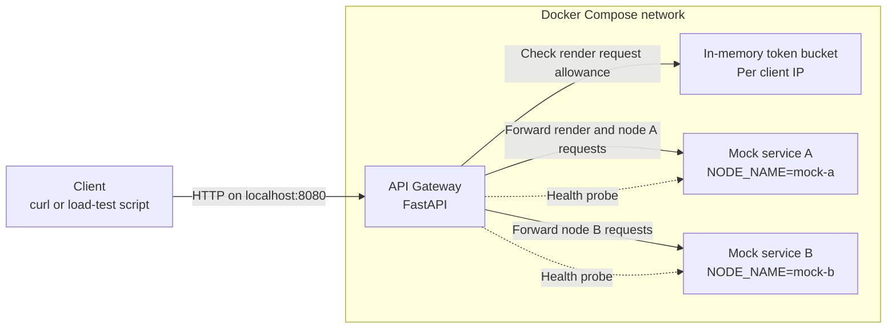
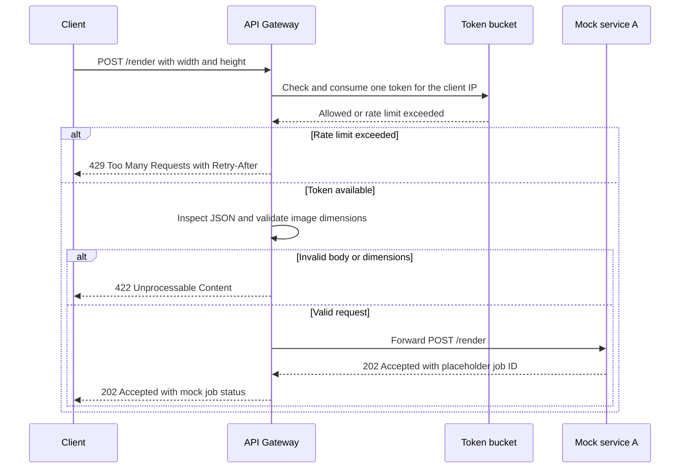
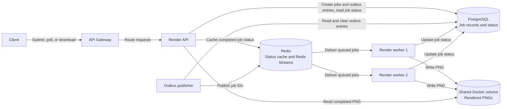

# Distributed Image Rendering Farm Architecture

## Project objective

The Distributed Image Rendering Farm accepts requests to generate Mandelbrot
PNG images. A client submits image settings, receives a job ID, and checks the
job's progress while a worker renders the image in the background.

Phase 1 establishes the API Gateway, routing, rate limiting, and health
reporting using two mock services. Figure 3 shows the current rendering farm.

## Figure 1 — Phase 1 deployment architecture



Docker Compose runs the Gateway and two instances of the same mock service
image. The Gateway is the public entry point on port `8080`. It reaches the
mock services on the internal Compose network using the names `mock-a` and
`mock-b`. The token bucket runs inside the Gateway process.

## Figure 2 — Phase 1 render request data flow



Each client IP starts with five tokens and earns one token per second, up to
the five-token capacity. Each `POST /render` attempt with an available token
consumes one token before body validation. Health and node-information
requests are exempt from this render limit.

For `GET /health`, the Gateway probes both mock nodes with a short timeout
and reports each node separately. For example, if `mock-b` stops, the
response body can report `mock-a` as `healthy` and `mock-b` as `unavailable`.

### Phase 1 endpoint contract

| Endpoint | Gateway behavior |
| --- | --- |
| `GET /health` | Probes both mock nodes and reports their individual health. |
| `GET /nodes/a/info` | Routes to `mock-a` and returns its node name. |
| `GET /nodes/b/info` | Routes to `mock-b` and returns its node name. |
| `POST /render` | Applies the rate limit, validates the JSON body, and forwards valid requests to `mock-a`. |

Example render request:

```json
{
  "width": 256,
  "height": 256
}
```

Example response with HTTP `202 Accepted`:

```json
{
  "job_id": "a6f4312c-2918-405f-9d16-c785e9eca441",
  "status": "mock"
}
```

## Figure 3 — Rendering farm architecture



### Full render job data flow

1. The client sends `POST /render` with the image settings. The Gateway
   checks the rate limit, validates the request, and forwards it to the
   Render API.
2. The Render API saves the job and outbox entry in one PostgreSQL
   transaction and returns `202 Accepted` with the job ID. A separate
   publisher sends the job ID to a Redis Stream and deletes the outbox
   entry after Redis accepts the message.
3. An available worker reads the job from Redis Streams, loads its
   settings, and records that it has started in PostgreSQL.
4. The worker renders the PNG, writes it to the shared volume, records
   completion in PostgreSQL, and acknowledges the queue message. If
   processing fails after the allowed retries, the worker records the
   failure in the job record.
5. The client calls `GET /jobs/{job_id}` to check progress. The Render API
   checks Redis for cached completed status and reads PostgreSQL on a
   cache miss.
6. After the job completes, the client downloads the PNG from
   `GET /jobs/{job_id}/image`. The Render API reads it from the shared
   volume.

## Resilience and observability

The publisher retries database and Redis failures with backoff. Redis
uses an append-only log with fsync on each write. Consumer groups retain
pending messages until a worker acknowledges them.
A worker reclaims idle pending messages after 60 seconds and obtains a
PostgreSQL advisory lock before rendering. The lock and terminal status
check make duplicate deliveries safe. Workers retry transient file errors
up to three render attempts. The gateway assigns an `X-Request-ID` to each
HTTP call. The submission request ID becomes the job's `X-Trace-ID`. The
Render API stores it with the job, the publisher carries it in Redis Streams,
and workers include it in processing and acknowledgement logs. The Render API
includes the same trace ID in database and cache events for status reads.

The concurrent load test measures accepted and completed jobs per second,
p50 and p95 latency, HTTP 429 responses, and cache hits. Run it with
caching enabled and disabled to compare repeated status reads.
